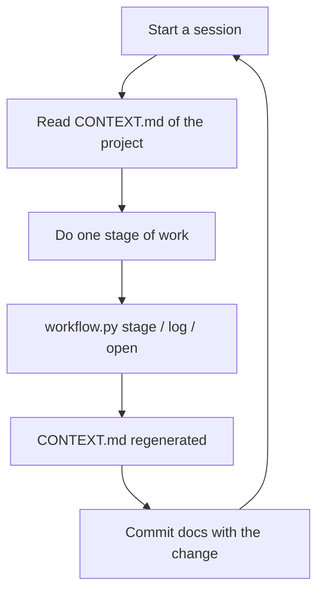

# EE design building blocks - context index

> Generated by `Chinmay_LIB/tools/workflow.py` on 2026-11-16. Read this first, then the CONTEXT.md of the project you are working on.

## How work flows

## Projects

| Project | Blocks / sheets | Done | Current stage | Next step |
|---|---|---|---|---|
| [Chinmay_BUCK](Chinmay_BUCK/docs/CONTEXT.md) | 9 | 8/11 | PCB layout in block | Convert sheets to design blocks, then lay out the first regulator |
| [Chinmay_LDO](Chinmay_LDO/docs/CONTEXT.md) | 7 | 8/11 | PCB layout in block | Convert sheets to design blocks |
| [Chinmay_MEMORY](Chinmay_MEMORY/docs/CONTEXT.md) | 10 | 8/11 | PCB layout in block | Lay out the NOR QSPI blocks first (length-matched IO, clock series R at source) |
| [Chinmay_USB2UART](Chinmay_USB2UART/docs/CONTEXT.md) | 9 | 8/11 | PCB layout in block | Convert sheets to design blocks |
| [Chinmay_WD_RST](Chinmay_WD_RST/docs/CONTEXT.md) | 17 | 8/11 | PCB layout in block | Convert sheets to design blocks |
| [Chinmay_XTAL](Chinmay_XTAL/docs/CONTEXT.md) | 48 | 8/11 | PCB layout in block | Lay out one crystal block (guard ring, no traces under the crystal) as the pattern for the rest |

## Shared library

`Chinmay_LIB` holds the footprints, STEP models, the generator scripts (`tools/`) and the method document.
Graphify indexes only the Python in `tools/`; KiCad files are covered by these context docs instead.
