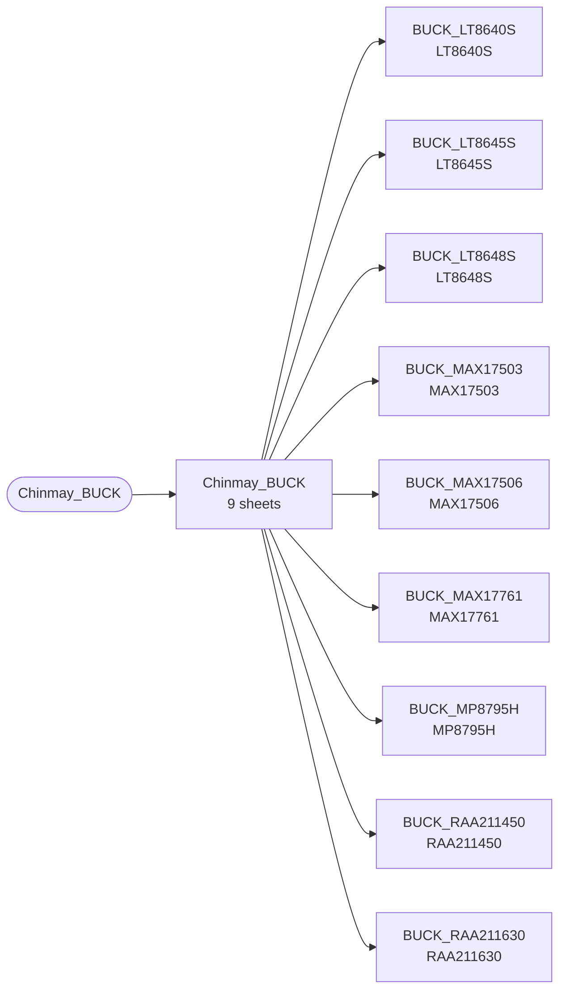

# Chinmay_BUCK - project context

> Generated by `Chinmay_LIB/tools/workflow.py` on 2026-11-16. Do not edit by hand: change `docs/workflow.json` through the tool, then `refresh`.

Nine buck regulator reference sheets (A3), with every component value calculated per sheet by `calc.py`.

## Where this project stands

**Next step:** Convert sheets to design blocks, then lay out the first regulator

| Stage | Status | Updated | Note |
|---|---|---|---|
| Select parts, check stock | done | 2026-11-14 |  |
| Datasheet capture | done | 2026-11-14 |  |
| Calculations | done | 2026-11-14 |  |
| Symbols | done | 2026-11-14 |  |
| Schematic / blocks | done | 2026-11-14 | Sheets, not design blocks yet |
| ERC + render check | done | 2026-11-14 |  |
| Footprint review | done | 2026-11-14 | MAX17503 corrected to 4x4 TQFN; 4 missing footprints drawn from datasheet lands |
| 3D models | done | 2026-11-14 | STEP models made in Fusion |
| PCB layout in block | not started |  | No block has a PCB layout yet |
| Peer review | not started |  |  |
| Merged to main | in progress | 2026-11-15 | PR #2 open against main |

## What is in the project

Green boxes already carry a PCB layout.

| Family | Block / sheet | Main part | MPN | Package | Parts | Layout |
|---|---|---|---|---|---|---|
| Chinmay_BUCK | BUCK_LT8640S | LT8640S | LT8640SEV#PBF | ADI_LQFN-24_4x4mm_P0.5mm_4xEP1.125mm_LT8640S | 13 | no |
| Chinmay_BUCK | BUCK_LT8645S | LT8645S | LT8645SEV#PBF | ADI_LQFN-32_4x6mm_P0.5mm_6xEP_LT8645S | 14 | no |
| Chinmay_BUCK | BUCK_LT8648S | LT8648S | LT8648SEV#PBF | ADI_LQFN-36_4x7mm_P0.5mm_6xEP_LT8648S | 18 | no |
| Chinmay_BUCK | BUCK_MAX17503 | MAX17503 | MAX17503ATP+ | Maxim_T2044-4C_TQFN-20-1EP_4x4mm_P0.5mm_EP2.85x2.85mm_ThermalVias | 13 | no |
| Chinmay_BUCK | BUCK_MAX17506 | MAX17506 | MAX17506ATP+ | TQFN-20-1EP_5x5mm_P0.65mm_EP3.25x3.25mm_ThermalVias | 18 | no |
| Chinmay_BUCK | BUCK_MAX17761 | MAX17761 | MAX17761ATC+ | Maxim_TDFN-12-1EP_3x3mm_P0.5mm_EP1.7x2.5mm | 15 | no |
| Chinmay_BUCK | BUCK_MP8795H | MP8795H | MP8795HGLE-Z | MPS_QFN-21_3x4mm_P0.4mm | 21 | no |
| Chinmay_BUCK | BUCK_RAA211450 | RAA211450 | RAA211450GSP#HA0 | HTSSOP-16-1EP_4.4x5mm_P0.65mm_EP3x3mm | 17 | no |
| Chinmay_BUCK | BUCK_RAA211630 | RAA211630 | RAA211630GSP#HA0 | HTSSOP-16-1EP_4.4x5mm_P0.65mm_EP3x3mm | 17 | no |

## Open items

1. Library paths are absolute (C:/Users/crmar/Documents/...); switch to a CHINMAY_LIB path variable before using from a clone _(opened 2026-11-15)_
2. Convert the nine sheets to design blocks _(opened 2026-11-15)_
3. Delete scratch.kicad_sch from the original folder _(opened 2026-11-15)_

## Decisions and changes (newest first)

- **2026-11-15** [release] Libraries registered globally in KiCad; folder copied into the repo; PR #2 opened
- **2026-11-14** [erc] Root project ERC: 0 violations after footprint changes
- **2026-11-14** [footprints] New footprints for LT8640S, LT8645S, LT8648S, MP8795H built from datasheet land patterns
- **2026-11-14** [footprints] MAX17503 was on a 5x5 P0.65 footprint; replaced with T2044-4C 4x4 P0.5 (land 90-0409)
