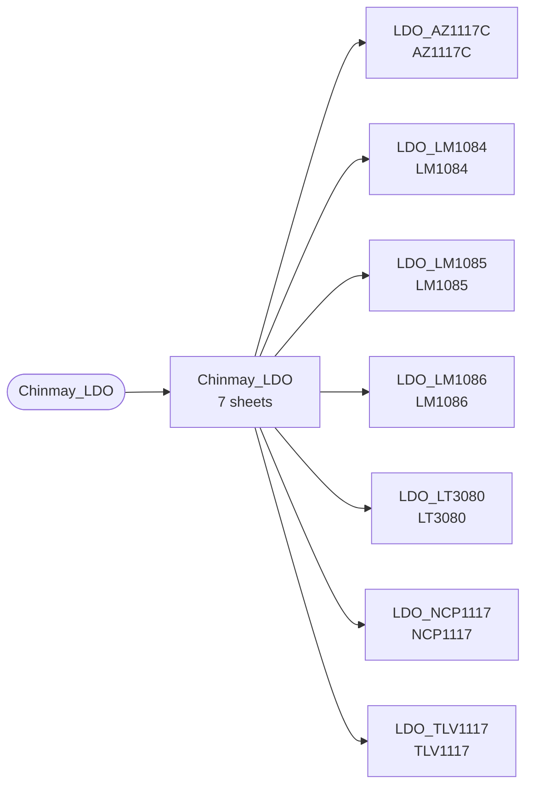

# Chinmay_LDO - project context

> Generated by `Chinmay_LIB/tools/workflow.py` on 2026-11-16. Do not edit by hand: change `docs/workflow.json` through the tool, then `refresh`.

Seven adjustable LDO reference sheets (1117-class SOT-223 and LM1084/5/6 TO-263).

## Where this project stands

**Next step:** Convert sheets to design blocks

```mermaid
flowchart LR
  parts["Select parts, check stock<br/>done"]:::done
  datasheet["Datasheet capture<br/>done"]:::done
  calc["Calculations<br/>done"]:::done
  symbols["Symbols<br/>done"]:::done
  schematic["Schematic / blocks<br/>done"]:::done
  erc["ERC + render check<br/>done"]:::done
  footprints["Footprint review<br/>done"]:::done
  models3d["3D models<br/>done"]:::done
  layout["PCB layout in block<br/>not started"]:::todo
  review["Peer review<br/>not started"]:::todo
  release["Merged to main<br/>in progress"]:::wip
  parts --> datasheet --> calc --> symbols --> schematic --> erc --> footprints --> models3d --> layout --> review --> release
  classDef done fill:#d5f0d5,stroke:#2e7d32,color:#111
  classDef wip fill:#fff3c4,stroke:#b58900,color:#111
  classDef todo fill:#eeeeee,stroke:#888,color:#111
  classDef na fill:#ffffff,stroke:#bbb,color:#888,stroke-dasharray:3
```

| Stage | Status | Updated | Note |
|---|---|---|---|
| Select parts, check stock | done | 2026-11-14 |  |
| Datasheet capture | done | 2026-11-14 |  |
| Calculations | done | 2026-11-14 |  |
| Symbols | done | 2026-11-14 |  |
| Schematic / blocks | done | 2026-11-14 | Sheets, not design blocks yet |
| ERC + render check | done | 2026-11-14 |  |
| Footprint review | done | 2026-11-14 |  |
| 3D models | done | 2026-11-14 | All from KiCad library |
| PCB layout in block | not started |  | No block has a PCB layout yet |
| Peer review | not started |  |  |
| Merged to main | in progress | 2026-11-15 | PR #2 open against main |

## What is in the project

Green boxes already carry a PCB layout.

| Family | Block / sheet | Main part | MPN | Package | Parts | Layout |
|---|---|---|---|---|---|---|
| Chinmay_LDO | LDO_AZ1117C | AZ1117C | AZ1117CH-ADJTRG1 | SOT-223-3_TabPin2 | 5 | no |
| Chinmay_LDO | LDO_LM1084 | LM1084 | LM1084ISX-ADJ/NOPB | TO-263-3_TabPin2 | 6 | no |
| Chinmay_LDO | LDO_LM1085 | LM1085 | LM1085ISX-ADJ/NOPB | TO-263-3_TabPin2 | 6 | no |
| Chinmay_LDO | LDO_LM1086 | LM1086 | LM1086ISX-ADJ/NOPB | TO-263-3_TabPin2 | 6 | no |
| Chinmay_LDO | LDO_LT3080 | LT3080 | LT3080EST#PBF | SOT-223-3_TabPin2 | 6 | no |
| Chinmay_LDO | LDO_NCP1117 | NCP1117 | NCP1117STAT3G | SOT-223-3_TabPin2 | 6 | no |
| Chinmay_LDO | LDO_TLV1117 | TLV1117 | TLV1117IDCYR | SOT-223-3_TabPin2 | 7 | no |

## Open items

1. Library paths are absolute (C:/Users/crmar/Documents/...); switch to a CHINMAY_LIB path variable before using from a clone _(opened 2026-11-15)_
2. Convert the seven sheets to design blocks _(opened 2026-11-15)_

## Decisions and changes (newest first)

- **2026-11-15** [release] Libraries registered globally in KiCad; folder copied into the repo; PR #2 opened
- **2026-11-14** [footprints] All footprints match datasheets; tab = pin 2 (VOUT) confirmed for every part
