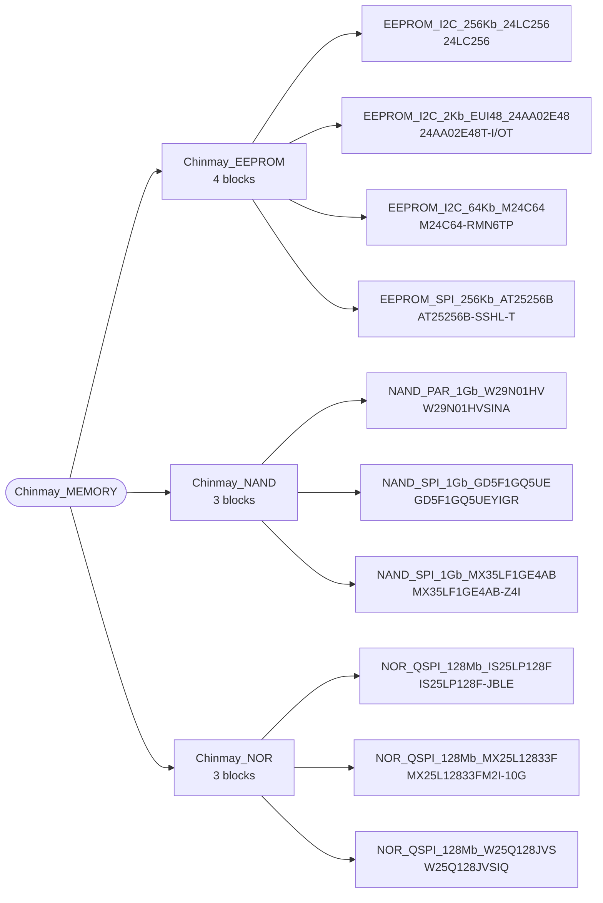

# Chinmay_MEMORY - project context

> Generated by `Chinmay_LIB/tools/workflow.py` on 2026-11-16. Do not edit by hand: change `docs/workflow.json` through the tool, then `refresh`.

EEPROM (4), NOR flash (3) and NAND flash (3) design blocks with termination provision and layout notes on each block.

## Where this project stands

**Next step:** Lay out the NOR QSPI blocks first (length-matched IO, clock series R at source)

```mermaid
flowchart LR
  parts["Select parts, check stock<br/>done"]:::done
  datasheet["Datasheet capture<br/>done"]:::done
  calc["Calculations<br/>done"]:::done
  symbols["Symbols<br/>done"]:::done
  schematic["Schematic / blocks<br/>done"]:::done
  erc["ERC + render check<br/>done"]:::done
  footprints["Footprint review<br/>done"]:::done
  models3d["3D models<br/>done"]:::done
  layout["PCB layout in block<br/>not started"]:::todo
  review["Peer review<br/>not started"]:::todo
  release["Merged to main<br/>in progress"]:::wip
  parts --> datasheet --> calc --> symbols --> schematic --> erc --> footprints --> models3d --> layout --> review --> release
  classDef done fill:#d5f0d5,stroke:#2e7d32,color:#111
  classDef wip fill:#fff3c4,stroke:#b58900,color:#111
  classDef todo fill:#eeeeee,stroke:#888,color:#111
  classDef na fill:#ffffff,stroke:#bbb,color:#888,stroke-dasharray:3
```

| Stage | Status | Updated | Note |
|---|---|---|---|
| Select parts, check stock | done | 2026-11-14 |  |
| Datasheet capture | done | 2026-11-14 |  |
| Calculations | done | 2026-11-14 |  |
| Symbols | done | 2026-11-14 |  |
| Schematic / blocks | done | 2026-11-14 |  |
| ERC + render check | done | 2026-11-14 |  |
| Footprint review | done | 2026-11-14 |  |
| 3D models | done | 2026-11-14 | WSON-8 8x6 model made in Fusion |
| PCB layout in block | not started |  | No block has a PCB layout yet |
| Peer review | not started |  |  |
| Merged to main | in progress | 2026-11-15 | PR #2 open against main |

## What is in the project

Green boxes already carry a PCB layout.

| Family | Block / sheet | Main part | MPN | Package | Parts | Layout |
|---|---|---|---|---|---|---|
| Chinmay_EEPROM | EEPROM_I2C_256Kb_24LC256 | 24LC256 | 24LC256T-I/SN | SOIC-8_3.9x4.9mm_P1.27mm | 11 | no |
| Chinmay_EEPROM | EEPROM_I2C_2Kb_EUI48_24AA02E48 | 24AA02E48T-I/OT | 24AA02E48T-I/OT | SOT-23-5 | 4 | no |
| Chinmay_EEPROM | EEPROM_I2C_64Kb_M24C64 | M24C64-RMN6TP | M24C64-RMN6TP | SOIC-8_3.9x4.9mm_P1.27mm | 11 | no |
| Chinmay_EEPROM | EEPROM_SPI_256Kb_AT25256B | AT25256B-SSHL-T | AT25256B-SSHL-T | SOIC-8_3.9x4.9mm_P1.27mm | 8 | no |
| Chinmay_NAND | NAND_PAR_1Gb_W29N01HV | W29N01HVSINA | W29N01HVSINA | TSOP-I-48_18.4x12mm_P0.5mm | 20 | no |
| Chinmay_NAND | NAND_SPI_1Gb_GD5F1GQ5UE | GD5F1GQ5UEYIGR | GD5F1GQ5UEYIGR | WSON-8-1EP_8x6mm_P1.27mm_EP3.4x4.3mm | 11 | no |
| Chinmay_NAND | NAND_SPI_1Gb_MX35LF1GE4AB | MX35LF1GE4AB-Z4I | MX35LF1GE4AB-Z4I | WSON-8-1EP_8x6mm_P1.27mm_EP3.4x4.3mm | 11 | no |
| Chinmay_NOR | NOR_QSPI_128Mb_IS25LP128F | IS25LP128F-JBLE | IS25LP128F-JBLE | SOIC-8_5.3x5.3mm_P1.27mm | 11 | no |
| Chinmay_NOR | NOR_QSPI_128Mb_MX25L12833F | MX25L12833FM2I-10G | MX25L12833FM2I-10G | SOIC-8_5.3x5.3mm_P1.27mm | 11 | no |
| Chinmay_NOR | NOR_QSPI_128Mb_W25Q128JVS | W25Q128JVSIQ | W25Q128JVSIQ | SOIC-8_5.3x5.3mm_P1.27mm | 11 | no |

## Open items

1. Library paths are absolute (C:/Users/crmar/Documents/...); switch to a CHINMAY_LIB path variable before using from a clone _(opened 2026-11-15)_
2. Chinmay_MEMORY.kicad_sch is a scratch sheet used to extract symbols; delete or keep as a test bench _(opened 2026-11-15)_

## Decisions and changes (newest first)

- **2026-11-15** [release] Libraries registered globally in KiCad; folder copied into the repo; PR #2 opened
- **2026-11-14** [erc] Block ERC shows only the expected standalone errors (undriven power, single-pin labels)
- **2026-11-14** [schematic] Termination: 27R on clocks/strobes, 0R provision on data, 10k on CS#/WP#/HOLD#, I2C 4.7k pull-ups DNP
- **2026-11-14** [parts] W25N01GV rejected (last-time-buy); GD5F1GQ5UE and MX35LF1GE4AB used for SPI NAND
