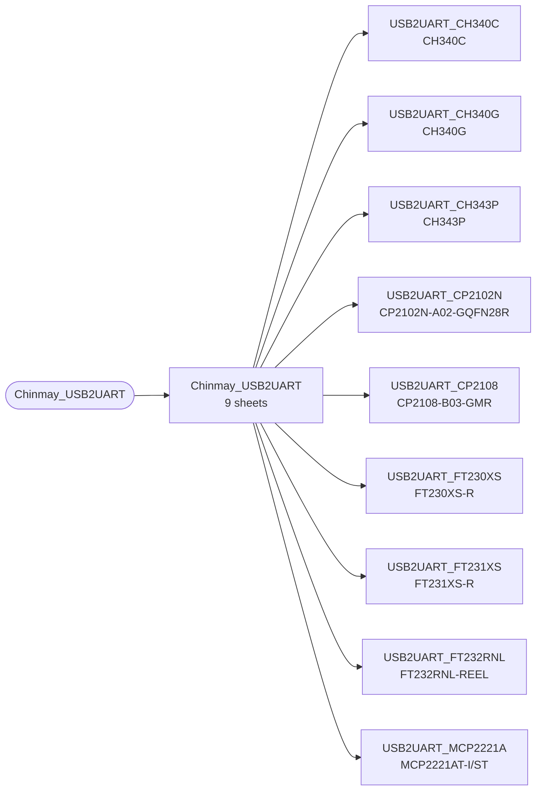

# Chinmay_USB2UART - project context

> Generated by `Chinmay_LIB/tools/workflow.py` on 2026-11-16. Do not edit by hand: change `docs/workflow.json` through the tool, then `refresh`.

Nine USB-to-UART bridge reference sheets (CH340/CH343, CP2102N/CP2108, FT230X/231X/232RNL, MCP2221A) with ESD protection. `docs/` also holds the per-block analysis kit (design_block_doc.html, marimo template, eq2calc).

## Where this project stands

**Next step:** Convert sheets to design blocks

| Stage | Status | Updated | Note |
|---|---|---|---|
| Select parts, check stock | done | 2026-11-14 |  |
| Datasheet capture | done | 2026-11-14 |  |
| Calculations | done | 2026-11-14 |  |
| Symbols | done | 2026-11-14 |  |
| Schematic / blocks | done | 2026-11-14 | Sheets; older block versions live in the repo root USB2UART folder |
| ERC + render check | done | 2026-11-14 |  |
| Footprint review | done | 2026-11-14 |  |
| 3D models | done | 2026-11-14 | CH343P QFN-16 model made in Fusion |
| PCB layout in block | not started |  | No block has a PCB layout yet |
| Peer review | not started |  |  |
| Merged to main | in progress | 2026-11-15 | PR #2 open against main |

## What is in the project

Green boxes already carry a PCB layout.

| Family | Block / sheet | Main part | MPN | Package | Parts | Layout |
|---|---|---|---|---|---|---|
| Chinmay_USB2UART | USB2UART_CH340C | CH340C | CH340C | SOIC-16_3.9x9.9mm_P1.27mm | 4 | no |
| Chinmay_USB2UART | USB2UART_CH340G | CH340G | CH340G | SOIC-16_3.9x9.9mm_P1.27mm | 7 | no |
| Chinmay_USB2UART | USB2UART_CH343P | CH343P | CH343P | WCH_QFN-16-1EP_3x3mm_P0.5mm_EP1.8x1.8mm | 5 | no |
| Chinmay_USB2UART | USB2UART_CP2102N | CP2102N-A02-GQFN28R | CP2102N-A02-GQFN28R | QFN-28-1EP_5x5mm_P0.5mm_EP3.35x3.35mm | 9 | no |
| Chinmay_USB2UART | USB2UART_CP2108 | CP2108-B03-GMR | CP2108-B03-GMR | QFN-64-1EP_9x9mm_P0.5mm_EP4.1x4.1mm | 11 | no |
| Chinmay_USB2UART | USB2UART_FT230XS | FT230XS-R | FT230XS-R | SSOP-16_3.9x4.9mm_P0.635mm | 9 | no |
| Chinmay_USB2UART | USB2UART_FT231XS | FT231XS-R | FT231XS-R | SSOP-20_3.9x8.7mm_P0.635mm | 9 | no |
| Chinmay_USB2UART | USB2UART_FT232RNL | FT232RNL-REEL | FT232RNL-REEL | SSOP-28_5.3x10.2mm_P0.65mm | 5 | no |
| Chinmay_USB2UART | USB2UART_MCP2221A | MCP2221AT-I/ST | MCP2221AT-I/ST | TSSOP-14_4.4x5mm_P0.65mm | 7 | no |

## Open items

1. Library paths are absolute (C:/Users/crmar/Documents/...); switch to a CHINMAY_LIB path variable before using from a clone _(opened 2026-11-15)_
2. Reconcile with the older USB2UART folder in the repo root _(opened 2026-11-15)_
3. Convert sheets to design blocks _(opened 2026-11-15)_

## Decisions and changes (newest first)

- **2026-11-15** [release] Libraries registered globally in KiCad; folder copied into the repo; PR #2 opened
- **2026-11-14** [footprints] All footprints match; CH343P re-pointed to Chinmay_Footprints for its 3D model
