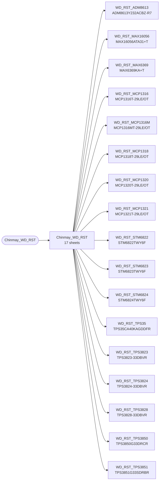

# Chinmay_WD_RST - project context

> Generated by `Chinmay_LIB/tools/workflow.py` on 2026-11-16. Do not edit by hand: change `docs/workflow.json` through the tool, then `refresh`.

Seventeen supervisor / watchdog / reset sheets (TPS38xx, TPS35, MCP131x, STM682x, MAX16056, MAX6369, ADM8613) with reset button and OR-ing logic.

## Where this project stands

**Next step:** Convert sheets to design blocks

| Stage | Status | Updated | Note |
|---|---|---|---|
| Select parts, check stock | done | 2026-11-14 |  |
| Datasheet capture | done | 2026-11-14 |  |
| Calculations | done | 2026-11-14 |  |
| Symbols | done | 2026-11-14 |  |
| Schematic / blocks | done | 2026-11-14 | Sheets; older block versions are the "WD and RST ..." blocks in the repo root |
| ERC + render check | done | 2026-11-14 |  |
| Footprint review | done | 2026-11-14 |  |
| 3D models | done | 2026-11-14 | ADM8613 WLCSP, TPS35 DDF and TPS3851 VSON models made in Fusion |
| PCB layout in block | in progress | 2026-11-16 | Generator run; DRC clearance errors on 12 of 18 blocks being fixed |
| Peer review | not started |  |  |
| Merged to main | in progress | 2026-11-15 | PR #2 open against main |

## What is in the project

Green boxes already carry a PCB layout.

| Family | Block / sheet | Main part | MPN | Package | Parts | Layout |
|---|---|---|---|---|---|---|
| Chinmay_WD_RST | WD_RST_ADM8613 | ADM8613Y232ACBZ-R7 | ADM8613Y232ACBZ-R7 | ADI_WLCSP-6_0.96x1.46mm_P0.5mm | 11 | no |
| Chinmay_WD_RST | WD_RST_MAX16056 | MAX16056ATA31+T | MAX16056ATA31+T | DFN-8-1EP_3x3mm_P0.65mm_EP1.5x2.25mm | 13 | no |
| Chinmay_WD_RST | WD_RST_MAX6369 | MAX6369KA+T | MAX6369KA+T | SOT-23-8 | 11 | no |
| Chinmay_WD_RST | WD_RST_MCP1316 | MCP1316T-29LE/OT | MCP1316T-29LE/OT | SOT-23-5 | 10 | no |
| Chinmay_WD_RST | WD_RST_MCP1316M | MCP1316MT-29LE/OT | MCP1316MT-29LE/OT | SOT-23-5 | 10 | no |
| Chinmay_WD_RST | WD_RST_MCP1318 | MCP1318T-29LE/OT | MCP1318T-29LE/OT | SOT-23-5 | 10 | no |
| Chinmay_WD_RST | WD_RST_MCP1320 | MCP1320T-29LE/OT | MCP1320T-29LE/OT | SOT-23-5 | 11 | no |
| Chinmay_WD_RST | WD_RST_MCP1321 | MCP1321T-29LE/OT | MCP1321T-29LE/OT | SOT-23-5 | 11 | no |
| Chinmay_WD_RST | WD_RST_STM6822 | STM6822TWY6F | STM6822TWY6F | SOT-23-5 | 11 | no |
| Chinmay_WD_RST | WD_RST_STM6823 | STM6823TWY6F | STM6823TWY6F | SOT-23-5 | 10 | no |
| Chinmay_WD_RST | WD_RST_STM6824 | STM6824TWY6F | STM6824TWY6F | SOT-23-5 | 10 | no |
| Chinmay_WD_RST | WD_RST_TPS35 | TPS35CA40KAGDDFR | TPS35CA40KAGDDFR | Texas_DDF0008A_SOT-8_1.6x2.9mm_P0.65mm | 11 | no |
| Chinmay_WD_RST | WD_RST_TPS3823 | TPS3823-33DBVR | TPS3823-33DBVR | SOT-23-5 | 10 | no |
| Chinmay_WD_RST | WD_RST_TPS3824 | TPS3824-33DBVR | TPS3824-33DBVR | SOT-23-5 | 10 | no |
| Chinmay_WD_RST | WD_RST_TPS3828 | TPS3828-33DBVR | TPS3828-33DBVR | SOT-23-5 | 11 | no |
| Chinmay_WD_RST | WD_RST_TPS3850 | TPS3850G33DRCR | TPS3850G33DRCR | VSON-10-1EP_3x3mm_P0.5mm_EP1.65x2.4mm | 11 | no |
| Chinmay_WD_RST | WD_RST_TPS3851 | TPS3851G33SDRBR | TPS3851G33SDRBR | VSON-8-1EP_3x3mm_P0.65mm_EP1.65x2.4mm | 11 | no |

## Open items

1. Library paths are absolute (C:/Users/crmar/Documents/...); switch to a CHINMAY_LIB path variable before using from a clone _(opened 2026-11-15)_
2. Delete unused Chinmay_Supervisor.pretty _(opened 2026-11-15)_
3. Reconcile with the older "WD and RST" blocks in the repo root _(opened 2026-11-15)_

## Decisions and changes (newest first)

- **2026-11-16** [layout] in progress: Generator run; DRC clearance errors on 12 of 18 blocks being fixed
- **2026-11-15** [release] Libraries registered globally in KiCad; folder copied into the repo; PR #2 opened
- **2026-11-14** [footprints] MAX16056 EP 2.25 vs 2.30 nominal: within tolerance, accepted
- **2026-11-14** [footprints] ADM8613 footprint moved to Chinmay_Footprints; Chinmay_Supervisor.pretty is now unused
