# Chinmay_XTAL - project context

> Generated by `Chinmay_LIB/tools/workflow.py` on 2026-11-16. Do not edit by hand: change `docs/workflow.json` through the tool, then `refresh`.

Twenty-four design blocks: 15 crystals with calculated load capacitors and 9 ECS-2520MV oscillators. The A3 sheets are the source the blocks were made from.

## Where this project stands

**Next step:** Lay out one crystal block (guard ring, no traces under the crystal) as the pattern for the rest

| Stage | Status | Updated | Note |
|---|---|---|---|
| Select parts, check stock | done | 2026-11-14 |  |
| Datasheet capture | done | 2026-11-14 |  |
| Calculations | done | 2026-11-14 | C1 = C2 = 2 x (CL - 3 pF stray), rounded to C0G E12 |
| Symbols | done | 2026-11-14 |  |
| Schematic / blocks | done | 2026-11-14 |  |
| ERC + render check | done | 2026-11-14 |  |
| Footprint review | done | 2026-11-14 |  |
| 3D models | done | 2026-11-14 | ECS-2520MV oscillator model made in Fusion |
| PCB layout in block | in progress | 2026-11-16 | 9 oscillator blocks laid out (6.6 x 6.6 mm, JLC 2-layer, DRC 0 errors); crystal blocks not yet |
| Peer review | not started |  |  |
| Merged to main | in progress | 2026-11-15 | PR #2 open against main |

## What is in the project

```mermaid
flowchart LR
  P(["Chinmay_XTAL"])
  P --> F0["Chinmay_XTAL<br/>48 blocks"]
  F0 --> B1["XO_100MHz_ECS2520MV<br/>100MHz"]:::lay
  F0 --> B2["XO_125MHz_ECS2520MV<br/>125MHz"]:::lay
  F0 --> B3["XO_12MHz_ECS2520MV<br/>12MHz"]:::lay
  F0 --> B4["XO_24MHz_ECS2520MV<br/>24MHz"]:::lay
  F0 --> B5["XO_25MHz_ECS2520MV<br/>25MHz"]:::lay
  F0 --> B6["XO_26MHz_ECS2520MV<br/>26MHz"]:::lay
  F0 --> B7["XO_33p3333MHz_ECS2520MV<br/>33.3333MHz"]:::lay
  F0 --> B8["XO_48MHz_ECS2520MV<br/>48MHz"]:::lay
  F0 --> B9["XO_50MHz_ECS2520MV<br/>50MHz"]:::lay
  F0 --> B10["XTAL_12MHz_ECX2236<br/>12MHz"]
  F0 --> B11["XTAL_16MHz_ECX2236<br/>16MHz"]
  F0 --> B12["XTAL_19p2MHz_ECX2236<br/>19.2MHz"]
  F0 --> B13["XTAL_20MHz_ECX2236<br/>20MHz"]
  F0 --> B14["XTAL_24MHz_ECX2236B2<br/>24MHz"]
  F0 --> B15["XTAL_24p576MHz_ECX2236B2<br/>24.576MHz"]
  F0 --> B16["XTAL_25MHz_ECX2236<br/>25MHz"]
  F0 --> B17["XTAL_26MHz_ECX2236<br/>26MHz"]
  F0 --> B18["XTAL_27MHz_ECX2236<br/>27MHz"]
  F0 --> B19["XTAL_32MHz_ECX2236<br/>32MHz"]
  F0 --> B20["XTAL_32p768kHz_ECX31B<br/>32.768kHz"]
  F0 --> B21["XTAL_38p4MHz_ECX2236B2<br/>38.4MHz"]
  F0 --> B22["XTAL_40MHz_ECX2236<br/>40MHz"]
  F0 --> B23["XTAL_48MHz_ECX2236B<br/>48MHz"]
  F0 --> B24["XTAL_8MHz_ECX33Q<br/>8MHz"]
  F0 --> B25["XO_1000<br/>100MHz"]
  F0 --> B26["XO_120<br/>12MHz"]
  F0 --> B27["XO_1250<br/>125MHz"]
  F0 --> B28["XO_240<br/>24MHz"]
  F0 --> B29["XO_250<br/>25MHz"]
  F0 --> B30["XO_260<br/>26MHz"]
  F0 --> B31["XO_333p3<br/>33.3333MHz"]
  F0 --> B32["XO_480<br/>48MHz"]
  F0 --> B33["XO_500<br/>50MHz"]
  F0 --> B34["XTAL_12M<br/>12MHz"]
  F0 --> B35["XTAL_16M<br/>16MHz"]
  F0 --> B36["XTAL_19M2<br/>19.2MHz"]
  F0 --> B37["XTAL_20M<br/>20MHz"]
  F0 --> B38["XTAL_24M<br/>24MHz"]
  F0 --> B39["XTAL_24M576<br/>24.576MHz"]
  F0 --> B40["XTAL_25M<br/>25MHz"]
  F0 --> B41["XTAL_26M<br/>26MHz"]
  F0 --> B42["XTAL_27M<br/>27MHz"]
  F0 --> B43["XTAL_32K768<br/>32.768kHz"]
  F0 --> B44["XTAL_32M<br/>32MHz"]
  F0 --> B45["XTAL_38M4<br/>38.4MHz"]
  F0 --> B46["XTAL_40M<br/>40MHz"]
  F0 --> B47["XTAL_48M<br/>48MHz"]
  F0 --> B48["XTAL_8M<br/>8MHz"]
  classDef lay fill:#d5f0d5,stroke:#2e7d32,color:#111
```

Green boxes already carry a PCB layout.

| Family | Block / sheet | Main part | MPN | Package | Parts | Layout |
|---|---|---|---|---|---|---|
| Chinmay_XTAL | XO_100MHz_ECS2520MV | 100MHz | ECS-2520MV-1000-BN-TR | Oscillator_SMD_ECS_2520MV-xxx-xx-4Pin_2.5x2.0mm | 4 | yes |
| Chinmay_XTAL | XO_125MHz_ECS2520MV | 125MHz | ECS-2520MV-1250-BN-TR | Oscillator_SMD_ECS_2520MV-xxx-xx-4Pin_2.5x2.0mm | 4 | yes |
| Chinmay_XTAL | XO_12MHz_ECS2520MV | 12MHz | ECS-2520MV-120-BN-TR | Oscillator_SMD_ECS_2520MV-xxx-xx-4Pin_2.5x2.0mm | 4 | yes |
| Chinmay_XTAL | XO_24MHz_ECS2520MV | 24MHz | ECS-2520MV-240-BN-TR | Oscillator_SMD_ECS_2520MV-xxx-xx-4Pin_2.5x2.0mm | 4 | yes |
| Chinmay_XTAL | XO_25MHz_ECS2520MV | 25MHz | ECS-2520MV-250-BN-TR | Oscillator_SMD_ECS_2520MV-xxx-xx-4Pin_2.5x2.0mm | 4 | yes |
| Chinmay_XTAL | XO_26MHz_ECS2520MV | 26MHz | ECS-2520MV-260-BN-TR | Oscillator_SMD_ECS_2520MV-xxx-xx-4Pin_2.5x2.0mm | 4 | yes |
| Chinmay_XTAL | XO_33p3333MHz_ECS2520MV | 33.3333MHz | ECS-2520MV-333.3-BN-TR | Oscillator_SMD_ECS_2520MV-xxx-xx-4Pin_2.5x2.0mm | 4 | yes |
| Chinmay_XTAL | XO_48MHz_ECS2520MV | 48MHz | ECS-2520MV-480-BN-TR | Oscillator_SMD_ECS_2520MV-xxx-xx-4Pin_2.5x2.0mm | 4 | yes |
| Chinmay_XTAL | XO_50MHz_ECS2520MV | 50MHz | ECS-2520MV-500-BN-TR | Oscillator_SMD_ECS_2520MV-xxx-xx-4Pin_2.5x2.0mm | 4 | yes |
| Chinmay_XTAL | XTAL_12MHz_ECX2236 | 12MHz | ECS-120-8-36-CKM-TR | Crystal_SMD_2520-4Pin_2.5x2.0mm | 5 | no |
| Chinmay_XTAL | XTAL_16MHz_ECX2236 | 16MHz | ECS-160-8-36CKM-TR | Crystal_SMD_2520-4Pin_2.5x2.0mm | 5 | no |
| Chinmay_XTAL | XTAL_19p2MHz_ECX2236 | 19.2MHz | ECS-192-8-36CKM-TR | Crystal_SMD_2520-4Pin_2.5x2.0mm | 5 | no |
| Chinmay_XTAL | XTAL_20MHz_ECX2236 | 20MHz | ECS-200-8-36CKM-TR | Crystal_SMD_2520-4Pin_2.5x2.0mm | 5 | no |
| Chinmay_XTAL | XTAL_24MHz_ECX2236B2 | 24MHz | ECS-240-8-36B2-CKM-TR | Crystal_SMD_2520-4Pin_2.5x2.0mm | 5 | no |
| Chinmay_XTAL | XTAL_24p576MHz_ECX2236B2 | 24.576MHz | ECS-245.7-10-36B2-CTM-TR | Crystal_SMD_2520-4Pin_2.5x2.0mm | 5 | no |
| Chinmay_XTAL | XTAL_25MHz_ECX2236 | 25MHz | ECS-250-8-36CKM-TR | Crystal_SMD_2520-4Pin_2.5x2.0mm | 5 | no |
| Chinmay_XTAL | XTAL_26MHz_ECX2236 | 26MHz | ECS-260-8-36CKM-TR | Crystal_SMD_2520-4Pin_2.5x2.0mm | 5 | no |
| Chinmay_XTAL | XTAL_27MHz_ECX2236 | 27MHz | ECS-270-8-36CKM-TR | Crystal_SMD_2520-4Pin_2.5x2.0mm | 5 | no |
| Chinmay_XTAL | XTAL_32MHz_ECX2236 | 32MHz | ECS-320-8-36CKM-TR | Crystal_SMD_2520-4Pin_2.5x2.0mm | 5 | no |
| Chinmay_XTAL | XTAL_32p768kHz_ECX31B | 32.768kHz | ECS-.327-7-34B-TR | Crystal_SMD_3215-2Pin_3.2x1.5mm | 4 | no |
| Chinmay_XTAL | XTAL_38p4MHz_ECX2236B2 | 38.4MHz | ECS-384-8-36B2-CTN-TR | Crystal_SMD_2520-4Pin_2.5x2.0mm | 5 | no |
| Chinmay_XTAL | XTAL_40MHz_ECX2236 | 40MHz | ECS-400-8-36CKM-TR | Crystal_SMD_2520-4Pin_2.5x2.0mm | 5 | no |
| Chinmay_XTAL | XTAL_48MHz_ECX2236B | 48MHz | ECS-480-10-36B-CKM-TR | Crystal_SMD_2520-4Pin_2.5x2.0mm | 5 | no |
| Chinmay_XTAL | XTAL_8MHz_ECX33Q | 8MHz | ECS-80-8-33Q-JES-TR | Crystal_SMD_3225-4Pin_3.2x2.5mm | 5 | no |
| Chinmay_XTAL | XO_1000 | 100MHz | ECS-2520MV-1000-BN-TR | Oscillator_SMD_ECS_2520MV-xxx-xx-4Pin_2.5x2.0mm | 4 | no |
| Chinmay_XTAL | XO_120 | 12MHz | ECS-2520MV-120-BN-TR | Oscillator_SMD_ECS_2520MV-xxx-xx-4Pin_2.5x2.0mm | 4 | no |
| Chinmay_XTAL | XO_1250 | 125MHz | ECS-2520MV-1250-BN-TR | Oscillator_SMD_ECS_2520MV-xxx-xx-4Pin_2.5x2.0mm | 4 | no |
| Chinmay_XTAL | XO_240 | 24MHz | ECS-2520MV-240-BN-TR | Oscillator_SMD_ECS_2520MV-xxx-xx-4Pin_2.5x2.0mm | 4 | no |
| Chinmay_XTAL | XO_250 | 25MHz | ECS-2520MV-250-BN-TR | Oscillator_SMD_ECS_2520MV-xxx-xx-4Pin_2.5x2.0mm | 4 | no |
| Chinmay_XTAL | XO_260 | 26MHz | ECS-2520MV-260-BN-TR | Oscillator_SMD_ECS_2520MV-xxx-xx-4Pin_2.5x2.0mm | 4 | no |
| Chinmay_XTAL | XO_333p3 | 33.3333MHz | ECS-2520MV-333.3-BN-TR | Oscillator_SMD_ECS_2520MV-xxx-xx-4Pin_2.5x2.0mm | 4 | no |
| Chinmay_XTAL | XO_480 | 48MHz | ECS-2520MV-480-BN-TR | Oscillator_SMD_ECS_2520MV-xxx-xx-4Pin_2.5x2.0mm | 4 | no |
| Chinmay_XTAL | XO_500 | 50MHz | ECS-2520MV-500-BN-TR | Oscillator_SMD_ECS_2520MV-xxx-xx-4Pin_2.5x2.0mm | 4 | no |
| Chinmay_XTAL | XTAL_12M | 12MHz | ECS-120-8-36-CKM-TR | Crystal_SMD_2520-4Pin_2.5x2.0mm | 5 | no |
| Chinmay_XTAL | XTAL_16M | 16MHz | ECS-160-8-36CKM-TR | Crystal_SMD_2520-4Pin_2.5x2.0mm | 5 | no |
| Chinmay_XTAL | XTAL_19M2 | 19.2MHz | ECS-192-8-36CKM-TR | Crystal_SMD_2520-4Pin_2.5x2.0mm | 5 | no |
| Chinmay_XTAL | XTAL_20M | 20MHz | ECS-200-8-36CKM-TR | Crystal_SMD_2520-4Pin_2.5x2.0mm | 5 | no |
| Chinmay_XTAL | XTAL_24M | 24MHz | ECS-240-8-36B2-CKM-TR | Crystal_SMD_2520-4Pin_2.5x2.0mm | 5 | no |
| Chinmay_XTAL | XTAL_24M576 | 24.576MHz | ECS-245.7-10-36B2-CTM-TR | Crystal_SMD_2520-4Pin_2.5x2.0mm | 5 | no |
| Chinmay_XTAL | XTAL_25M | 25MHz | ECS-250-8-36CKM-TR | Crystal_SMD_2520-4Pin_2.5x2.0mm | 5 | no |
| Chinmay_XTAL | XTAL_26M | 26MHz | ECS-260-8-36CKM-TR | Crystal_SMD_2520-4Pin_2.5x2.0mm | 5 | no |
| Chinmay_XTAL | XTAL_27M | 27MHz | ECS-270-8-36CKM-TR | Crystal_SMD_2520-4Pin_2.5x2.0mm | 5 | no |
| Chinmay_XTAL | XTAL_32K768 | 32.768kHz | ECS-.327-7-34B-TR | Crystal_SMD_3215-2Pin_3.2x1.5mm | 4 | no |
| Chinmay_XTAL | XTAL_32M | 32MHz | ECS-320-8-36CKM-TR | Crystal_SMD_2520-4Pin_2.5x2.0mm | 5 | no |
| Chinmay_XTAL | XTAL_38M4 | 38.4MHz | ECS-384-8-36B2-CTN-TR | Crystal_SMD_2520-4Pin_2.5x2.0mm | 5 | no |
| Chinmay_XTAL | XTAL_40M | 40MHz | ECS-400-8-36CKM-TR | Crystal_SMD_2520-4Pin_2.5x2.0mm | 5 | no |
| Chinmay_XTAL | XTAL_48M | 48MHz | ECS-480-10-36B-CKM-TR | Crystal_SMD_2520-4Pin_2.5x2.0mm | 5 | no |
| Chinmay_XTAL | XTAL_8M | 8MHz | ECS-80-8-33Q-JES-TR | Crystal_SMD_3225-4Pin_3.2x2.5mm | 5 | no |

## Open items

1. Library paths are absolute (C:/Users/crmar/Documents/...); switch to a CHINMAY_LIB path variable before using from a clone _(opened 2026-11-15)_

## Decisions and changes (newest first)

- **2026-11-16** [layout] in progress: 9 oscillator blocks laid out (6.6 x 6.6 mm, JLC 2-layer, DRC 0 errors); crystal blocks not yet
- **2026-11-15** [release] Libraries registered globally in KiCad; folder copied into the repo; PR #2 opened
- **2026-11-14** [footprints] Oscillator blocks and sheets re-pointed to Chinmay_Footprints
- **2026-11-14** [schematic] Blocks use label-driven passives, no wires; refs left unannotated
